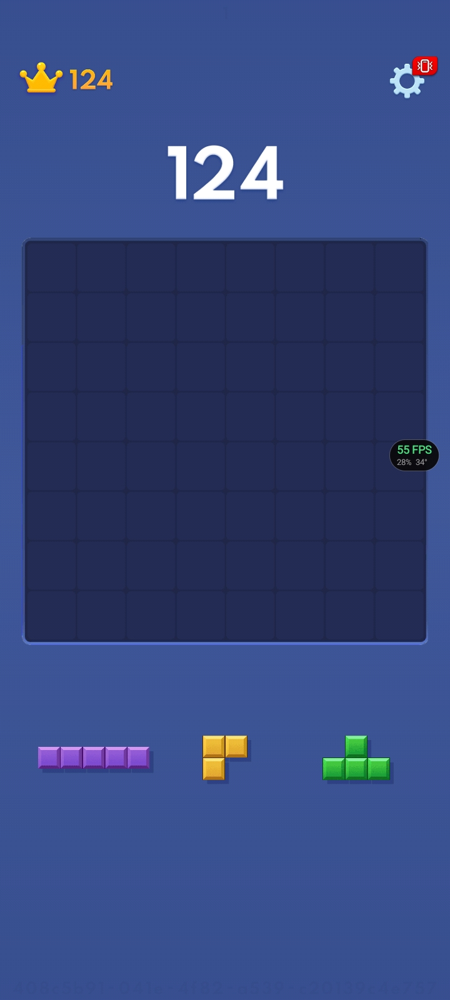
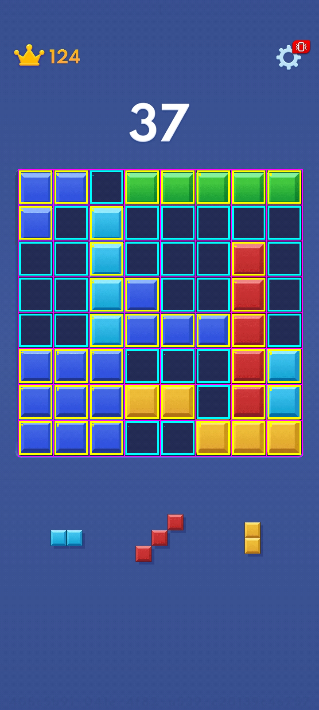

<div align="center">

# BlockBlast : Player

**An Android app that shows you the best three moves for Block Blast — and lets *you* place them.**

[](../../actions/workflows/build.yml)
[](https://kotlinlang.org)
[](https://developer.android.com)
[](https://developer.android.com/jetpack/compose)
[](https://gradle.org)
[](#tech-stack)
[](#tech-stack)
[](#tech-stack)
[](#tech-stack)
[](#tests)
[](LICENSE)

`capture` → `detect` → `solve` → `overlay`

</div>

---

## What it does

You play Block Blast. This app watches the board, works out the **optimal
order and position for all three blocks**, and paints numbered ghost blocks
(1, 2, 3) over your screen showing exactly where each one goes.

<div align="center">

| Empty board + tray | Detected grid | The suggestion |
|:---:|:---:|:---:|
|  |  | numbered ghosts 1 / 2 / 3 |

</div>

> ### It draws the answer. **You** make the move.
> The overlay is a plain drawing layer with `FLAG_NOT_TOUCHABLE` — every tap
> goes straight through to the game. There is **no input-injection code
> anywhere in this project**. See [Why suggest-only](#why-suggest-only-).

---

## Contents

| Section | What you get |
|---|---|
| [Quick start](#quick-start) | Build it, install it, use it |
| [Architecture](#architecture) | The pipeline and the module layout |
| [The solver](#the-solver) | Exhaustive search + the heuristic |
| [Computer vision](#computer-vision) | Measured constants, not guesses |
| [Tests](#tests) | What is verified, and against what |
| [Why suggest-only](#why-suggest-only-) | The design decision, argued |
| [School report](#for-the-school-report) | A ready outline to write up |
| [Credits](#credits) | Licences and attribution |
| [Contributing](#contributing) | How to help |

---

## Quick start

### Build on GitHub (recommended — no heavy phone needed)

```bash
git clone <your-repo-url>
cd blockblast
```

Push, then open **Actions → Build debug APK → Run workflow**. When it goes
green, download `blockblast-player-debug-apk` from the job summary.

### Build locally

```bash
./gradlew assembleDebug        # APK at app/build/outputs/apk/debug/
./gradlew test                 # unit tests, plain JVM, no device
```

### Install on your phone

```bash
adb install -r app/build/outputs/apk/debug/app-debug.apk
```

Or copy the APK across and allow **Install unknown apps** for your file
manager.

### The four tabs

| Tab | Needs permissions? | What it does |
|---|---|---|
| **Manual** | ❌ none | Type a board in by hand, pick 3 shapes, press **Solve**. The school-project mode. |
| **Live** | ✅ 2–3 | Screen capture + floating overlay with numbered ghosts. |
| **Calibrate** | ❌ none | Fix detection by hand if your phone disagrees. |
| **How it works** | ❌ none | The short explainer, written to be read out. |

### Permissions, in plain language

| Permission | Kind | Why | Where it is explained |
|---|---|---|---|
| `SYSTEM_ALERT_WINDOW` | Settings switch | Android only lets an app draw over others if *you* flip this | Live tab, step 1 |
| `POST_NOTIFICATIONS` | Runtime (API 33+) | Android 13+ blocks notifications without it | Live tab, step 3 |
| Screen capture | System dialog | Android's own "Start recording" consent | Live tab, step 2 |

Each is requested **only** from the Live tab, **only** after being explained in
plain words, and the app **degrades gracefully**: if capture is refused you
still have the full Manual mode.

---

## Architecture

The app is one straight line of four stages. Nothing branches, nothing loops
back, and only the last stage touches the screen.

```
 ┌───────────────────────────────────────────────────────────────────────────┐
 │ 1. CAPTURE                                    vision/ScreenCapture.kt    │
 │                                                                           │
 │   MediaProjection ──► ImageReader ──► RgbImage(720 x 1600)                │
 │                                                                           │
 │   MediaProjection is the one permission that looks scary. Frames live in  │
 │   memory for a few hundred ms and are then dropped. The app has no        │
 │   INTERNET permission at all, so they cannot be sent anywhere.            │
 └───────────────────────────────────┬───────────────────────────────────────┘
                                     │  IntArray of 0xRRGGBB
                                     ▼
 ┌───────────────────────────────────────────────────────────────────────────┐
 │ 2. DETECT                                     vision/BoardReader.kt      │
 │                                                                           │
 │   ┌─ GridDetector ─────────────┐      ┌─ TrayDetector ───────────────┐    │
 │   │ flood fill the navy gap    │      │ colour blobs below the board │    │
 │   │ network -> panel rect      │      │ -> block size -> shape      │    │
 │   └─────────────┬──────────────┘      └──────────────┬───────────────┘    │
 │                 │                                    │                    │
 │   median-of-5 cell-centre sampling                   │                    │
 │                 ▼                                    ▼                    │
 │        8x8 BooleanArray              List<Piece>  (0..3 read)             │
 └───────────────────────────────────┬───────────────────────────────────────┘
                                     │  Solvable input  (pure Kotlin)
                                     ▼
 ┌───────────────────────────────────────────────────────────────────────────┐
 │ 3. SOLVE                                 solver/BlockBlastSolver.kt       │
 │                                                                           │
 │   pass 1   3! orders x every legal position x every rotation              │
 │            ~1.5M leaves, cheap terms only  -> shortlist of 256             │
 │   pass 2   holes, fragments, free space, dead-end risk -> the winner       │
 │                                                                           │
 │   guards:  dead-end pruning  |  1.2 s time budget  |  node cap             │
 └───────────────────────────────────┬───────────────────────────────────────┘
                                     │  List<Move(pieceIndex, row, col)>
                                     ▼
 ┌───────────────────────────────────────────────────────────────────────────┐
 │ 4. OVERLAY                                   overlay/OverlayService.kt    │
 │                                                                           │
 │   GhostOverlayView      TYPE_APPLICATION_OVERLAY                          │
 │     numbered ghosts 1/2/3     FLAG_NOT_TOUCHABLE  <-- taps pass through   │
 │     one colour per step                                                 │
 │   FloatingButtonView    draggable | tap = analyse | tap = auto-refresh    │
 │                                                                           │
 │   a foreground service because Android 14 requires one for MediaProjection │
 └───────────────────────────────────────────────────────────────────────────┘
```

### The one boundary that matters

```kotlin
// vision/RgbImage.kt -- a plain array. No Bitmap, no Android anywhere.
class RgbImage(val width: Int, val height: Int, val pixels: IntArray)
```

Stages 2 and 3 are written entirely against that single type. That is why:

- the **identical** `BoardReader` runs on the phone *and* in a JVM unit test,
- the tests load a **real JPEG** with `javax.imageio` and assert on it,
- the solver has no idea a screen exists, so it is trivially testable.

Change that type and you lose the whole testing story — see
[CONTRIBUTING.md](.github/CONTRIBUTING.md).

### Module layout

```
app/src/main/java/com/example/blockblastplayer/
│
├── solver/          ZERO Android imports -- runs in plain JVM tests
│   ├── Board.kt              8x8 grid held twice: BooleanArray for reading,
│   │                         Long bitmask for the hot path, kept in sync
│   ├── Piece.kt              trimmed boolean matrix + rotations + ASCII art
│   ├── PieceLibrary.kt       every Block Blast shape the game deals
│   ├── BoardAnalysis.kt      holes - empty regions - empty rectangles -
│   │                         look-ahead risk (the "facts")
│   ├── Heuristic.kt          the weights, as a plain data class
│   └── BlockBlastSolver.kt   exhaustive search + two-pass scoring
│
├── vision/          BoardReader, GridDetector, TrayDetector are Android-free
│   ├── RgbImage.kt           plain IntArray + colour distance
│   ├── Calibration.kt        every measured constant, with its provenance
│   ├── BoardReader.kt        detect panel -> read board  (the entry point)
│   ├── GridDetector.kt       flood fill + median cell-centre sampling
│   ├── TrayDetector.kt       colour blobs -> block size -> shape
│   ├── CalibrationStore.kt   persists the user's tweaks
│   ├── ScreenCapture.kt      MediaProjection -> RgbImage
│   └── LastFrame.kt          the last frame, for the calibration preview
│
├── overlay/
│   ├── OverlayService.kt     foreground service: capture -> solve -> draw
│   ├── GhostOverlayView.kt   the numbered ghost blocks
│   └── FloatingButtonView.kt the draggable bubble
│
├── ui/              Jetpack Compose
│   ├── MainActivity.kt       tabs + all permission plumbing
│   ├── manual/               Manual mode + the shared 8x8 grid widget
│   ├── vision/               Live tab + Calibrate tab
│   ├── docs/                 "How it works"
│   └── theme/
│
app/src/test/java/com/example/blockblastplayer/
├── solver/          BoardTest - LineClearTest - BlockBlastSolverTest
└── vision/          SampleScreenshotTest  (loads the real JPEGs)
```

### What talks to what

| From | To | Via | Runs on | Note |
|---|---|---|---|---|
| `OverlayService` | `ScreenCapture` | MediaProjection | service thread | only while the service is up |
| `OverlayService` | `BoardReader` | `RgbImage` | `Dispatchers.Default` | the one heavy step |
| `OverlayService` | `BlockBlastSolver` | `Board` + `List<Piece>` | `Dispatchers.Default` | 1.2 s budget |
| `OverlayService` | `GhostOverlayView` | `List<Move>` | main thread | results are posted back |
| `OverlayService` | `CalibrationStore` | `Calibration` | service thread | re-read every analysis |
| `VisionScreen` | `MainActivity` | callbacks | main thread | the only permission plumbing |
| `CalibrationScreen` | `LastFrame` | `RgbImage` | main thread | preview only |
| `ManualModeScreen` | `BlockBlastSolver` | `Board` + `List<Piece>` | `Dispatchers.Default` | **needs no permissions at all** |

`ManualModeScreen` never touches the other three stages — it builds a `Board`
from taps and goes straight to the solver. That is what makes the demo work
with every permission switched off.

---

## The solver

### Search — exhaustive, not greedy

A round is an **ordered sequence** of three placements. The solver

1. enumerates all `3! = 6` orderings,
2. for each order tries **every legal position** of the next block, in every rotation,
3. resolves line clears immediately after each placement — rows and columns clear *together*, exactly as in the game,
4. scores the finished position and keeps the best.

```
worst case  =  6 × 64 × 64 × 64  ≈  1.5 million complete sequences
```

Depth is 3 and branching is ≤64, so exhaustive search is genuinely affordable
on a phone. That means the answer is **optimal under the heuristic**, not a
local guess — which is a much stronger claim than "it tries the obvious moves".

Two guards keep it honest and fast:

- a block with **no legal position** kills the whole branch (dead end),
- a **hard 1.2 s time budget** plus a node cap stop the search on slow phones.
  You still always get a legal move — just maybe not the optimum, and the app
  tells you when that happened.

### Scoring

```text
score =  +100  per line cleared
      +   60 × (multi-line blast − 1)²      two lines at once ≫ two lines apart
      +   25  per extra step of a combo streak
      −   12  per hole                     empty cell with a block above it (×2 if sealed)
      −    8  per separate empty region    a scattered board refuses blocks soon
      +    6 × √(largest empty rectangle)  keep one roomy area, not confetti
      −   18  per common shape that no longer fits anywhere
      −  400  if the board ends the round completely full
```

Each weight lives in `HeuristicWeights` as a plain `Double`, so the report can
tabulate them and the UI can explain *why* a move won.

### Why two passes, not one

Lines and combos are **free** — the search already knows them. The
look-ahead term ("can the *next* round still be placed?") probes 9 small
shapes × up to 4 rotations × 64 squares ≈ 11 000 operations. Running that on
1.5M leaves would take **minutes**.

So the *same exhaustive tree* is scored in two stages:

| Pass | Runs on | Cost per item | What it does |
|---|---|---|---|
| **1 — cheap** | every leaf (1.5M) | ~10 ops | rank by lines + combo, keep a shortlist of the best **256** |
| **2 — full** | the shortlist only (256) | ~12 000 ops | holes, fragments, free space, risk → pick the winner |

**Nothing is skipped** — every ordering and every legal placement is still
considered. Only the *ordering of the scoring* is cheap-first. That is what
keeps the button responsive on your phone.

---

## Computer vision

> **Every constant below was measured from the three real screenshots in
> `samples/`.** None were guessed. Reproduce them yourself:
> ```bash
> python3 tools/detect_final.py samples/shot1.jpg samples/shot2.jpg samples/shot3.jpg
> ```

### Measured values (720 × 1600 screen)

| Quantity | Value |
|---|---|
| Board panel | `x 40..681 (642 px)`, `y 386..1026 (641 px)`, aspect `1.0016` |
| Cell size | `80.25 × 80.13 px` |
| Empty cell centre | `RGB(38, 46, 85)` |
| Grid gap / panel edge | `RGB(25, 33, 69)` |
| Page background | `RGB(58, 82, 146)` |
| Tray block size | `≈ 35 px` — much smaller than a board cell |
| Tray slot centres | `x = 149.5, 359.5, 569.5` (pitch 210) |

### The two decisions that mattered

**1. Find the panel by flood fill, not by thresholds.**

The first version counted *"dark pixels per row"*. It worked on an empty
board and **fell over the moment the board filled up**, because a row of solid
blocks is not dark — the panel shrank to a 241×253 fragment.

The gaps *between* cells are always navy and always 4-connected, so the
bounding box of the **largest connected component** of navy pixels is the
panel, empty or full. It also discards the panel's own drop shadow and a
floating **"55 FPS" booster badge**, because those are dark but *not connected*
to the gap network.

**2. Empty vs filled is one distance threshold — and it is not delicate.**

Across every sample, empty cells sit within **14** of `RGB(38,46,85)`, while
filled cells sit at least **133** away. A threshold of **60** sits in the
middle of that gap:

```text
empty cells   0 ├────────── 14  ▓▓  60 ← threshold ── 133 ▓▓▓▓▓────────── 368  filled cells
```

Each cell is sampled as the **median of five** nearby pixels, so JPEG noise
cannot flip a single cell.

### Verified results

| Screenshot | Board read | Tray pieces read |
|---|---|---|
| `shot1.jpg` | empty* | 5-bar, L-tromino, T-tetromino |
| `shot2.jpg` | empty | 1×2 domino, L-tromino, 1×3 bar |
| `shot3.jpg` | **37/64 cells, exactly as drawn** | 2-bar, S-zigzag, 1×2 |

\* `shot1` contains a black "55 FPS" booster badge covering cell (4,7), and the
reader reports it as filled. That is the **honest measured result** — it is a
genuine failure mode, it is asserted in a test, and it is why the app tells you
to switch such overlays off before a demo.

---

## Tests

```bash
./gradlew test     # plain JVM — no device, no emulator
```

CI runs these **before** assembling the APK, so a broken solver never ships.

| Suite | Covers |
|---|---|
| `BoardTest` | set/get, mask ↔ boolean sync, parsing, independence of copies |
| `LineClearTest` | full rows, full columns, both at once, idempotency, sync after clear |
| `PlacementTest` | legal positions, off-edge rejection, overlap rejection, rotations |
| `BlockBlastSolverTest` | every suggested move re-checked for legality, the line-completing move is found, determinism, the time budget returns a usable move, empty ≻ cramped |
| `SampleScreenshotTest` | **the real screenshots** → panel rect, 8×8 board, tray shapes, and the colour separation margin |

The vision tests read the actual JPEGs from `samples/` via `javax.imageio`,
which is why they run on a JVM and why they are worth trusting.

---

## Why suggest-only

The overlay window uses `FLAG_NOT_TOUCHABLE`, and this project contains **no
input-injection code** — no `AccessibilityService`, no simulated touches.

That is a deliberate engineering decision, and the reasoning belongs in the
report:

1. **It would break the game.** Automating Block Blast violates its rules and
   gets the account banned. Your account is worth more than the demo.
2. **It would break distribution.** An accessibility-service "bot" is
   explicitly *not* eligible for Google Play.
3. **It would weaken the project.** The report is about the search algorithm and
   the vision pipeline. A tap-injection layer sits on top of both and
   demonstrates neither.
4. **The permission is the real risk.** `AccessibilityService` grants permanent
   read-and-tap access to the *entire screen, always*. A project should not ask
   for that in order to draw some rectangles.

If you want to watch the solver play itself, **Manual mode + Solve** exercises
the identical solver end-to-end, safely.

---

## Tech stack

| | |
|---|---|
| Language | Kotlin 1.9.24 (JVM target 17) |
| UI | Jetpack Compose (BOM 2024.06) + Material 3 |
| Architecture | single-activity + `foregroundServiceType="mediaProjection"` |
| Vision | `MediaProjection` → `ImageReader` → plain `IntArray` |
| Overlay | `WindowManager` `TYPE_APPLICATION_OVERLAY`, `FLAG_NOT_TOUCHABLE` |
| Build | Gradle 8.7 wrapper, AGP 8.5.2 |
| min / target SDK | **26** / **34** |
| Tests | JUnit 4 on a plain JVM |
| Permissions asked | `SYSTEM_ALERT_WINDOW`, `POST_NOTIFICATIONS`, screen capture |
| Permissions *never* asked | `AccessibilityService`, `INTERNET` |

> **There is no `INTERNET` permission.** The app cannot phone home, by
> construction rather than by promise.

---

## For the school report

1. **Problem.** Choose an order and position for three polyominoes on an 8×8
   board, leaving the position in the best possible shape.
2. **Search.** Exhaustive over `3! × 64³`. *Justify it:* bounded depth 3 and
   branching 64 give ≈1.5M leaves, so exhaustive is affordable and no
   move-pruning heuristics are needed. Contrast with a greedy "best move now".
3. **Evaluation function.** Tabulate the weights and give a board position
   where each term changes the answer. The look-ahead term is the most
   interesting: it optimises the **next** round, not this one.
4. **Vision.** Show the measurement table; explain why flood fill beat
   thresholding (with the failing screenshot); discuss the separation gap
   (`14` vs `133`) and why the threshold is safe rather than tuned.
5. **Evaluate the vision.** Run the detector on all three screenshots. Use
   `shot1`'s FPS-badge false positive as a genuine, honest failure mode.
6. **Limitations & future work.**
   - exact minimum-rectangle-cover fragmentation instead of the greedy version,
   - search over *two* rounds for a stronger look-ahead,
   - learn the weights instead of hand-tuning, then compare against the
     heuristic (this is where the RL reference project becomes relevant),
   - reject the FPS badge by requiring cells to match a known palette.
7. **Ethics.** State plainly that the app advises and does not play, and argue
   why. This is the strongest design decision in the project.

---

## Credits

Full detail in **[CREDITS.md](CREDITS.md)**. In short:

| Reference | Licence | Used for |
|---|---|---|
| [Joey239716/BlockBlast-Solver-CPP](https://github.com/Joey239716/BlockBlast-Solver-CPP) | **none** (all rights reserved) | ideas only |
| [RisticDjordje/BlockBlast-Game-AI-Agent](https://github.com/RisticDjordje/BlockBlast-Game-AI-Agent) | **none** on GitHub | ideas only |
| [DrakeSeteraO/Block-Blast-Best-Move-Solver](https://github.com/DrakeSeteraO/Block-Blast-Best-Move-Solver) | **MIT** | ideas only, attributed |

All Kotlin in this repository is original. No code was copied from any of the
three, because two of them carry no licence that would allow it and the third
did not need to be.

Block Blast is a trademark of its respective owner. This project is not
affiliated with, endorsed by, or sponsored by its publisher.

---

## Contributing

Issues and pull requests are welcome — see **[CONTRIBUTING.md](.github/CONTRIBUTING.md)**
for the three invariants you should not break.

---

## Author

Built as a school project, on a low-end phone, from real screenshots and real
measurements rather than assumptions.

| | |
|---|---|
| **Developer** | **Inkflow-Gab** |
| **GitHub** | [@Inkflow-Gab](https://github.com/Inkflow-Gab) |
| **Repository** | [Inkflow-Gab/blockblast-player](https://github.com/Inkflow-Gab/blockblast-player) |
| **Built with** | Kotlin, Jetpack Compose, Gradle 8.7, AGP 8.5.2 |
| **APK** | built by GitHub Actions → [Actions tab](https://github.com/Inkflow-Gab/blockblast-player/actions) |

The measurement scripts used to derive the vision constants live in
[`tools/`](tools), so every number in this README can be checked:

```bash
python3 tools/detect_final.py samples/shot1.jpg samples/shot2.jpg samples/shot3.jpg
python3 tools/overlay_check.py  samples/shot3.jpg samples/shot3_marked.png
```

Questions about the algorithm or the vision pipeline? Open an issue — that is
faster than email and helps the next person too.

---

## Licence

[MIT](LICENSE) © BlockBlast : Player contributors.

---

<div align="center">
<sub>Made for a school project, on a low-end phone, with real screenshots.</sub>
</div>